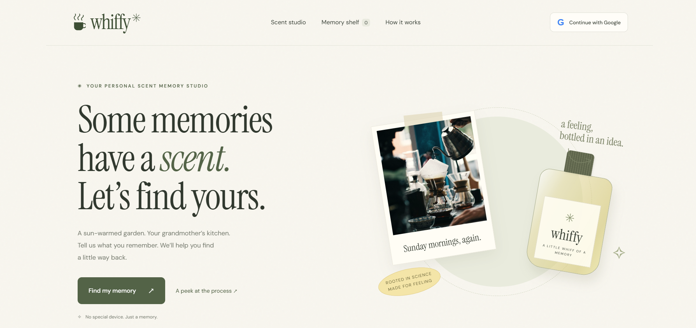
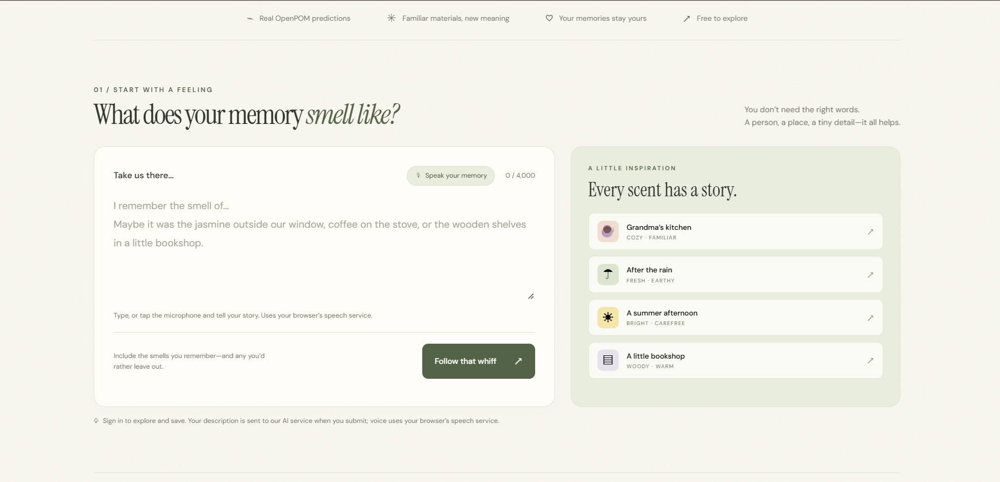
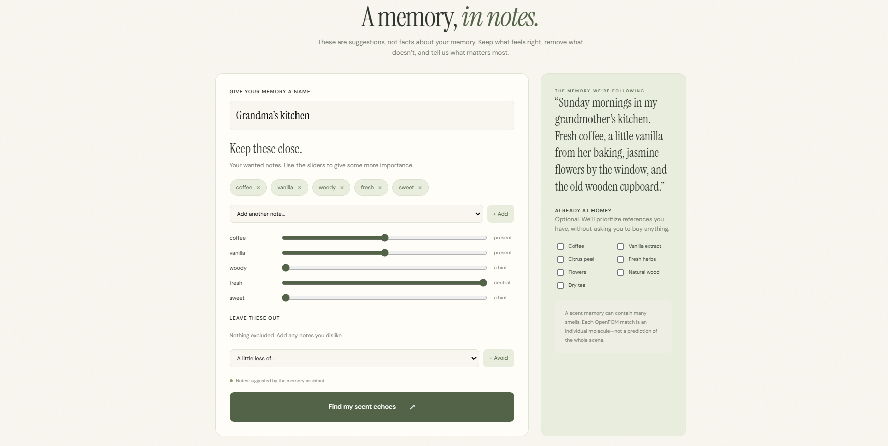
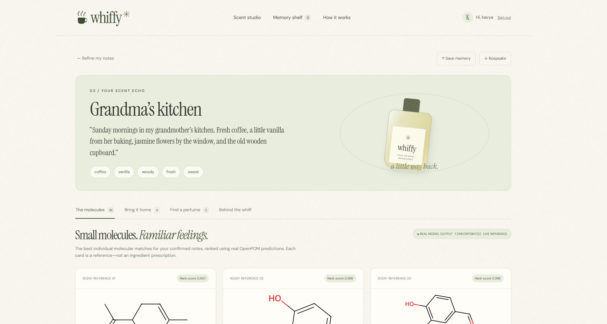
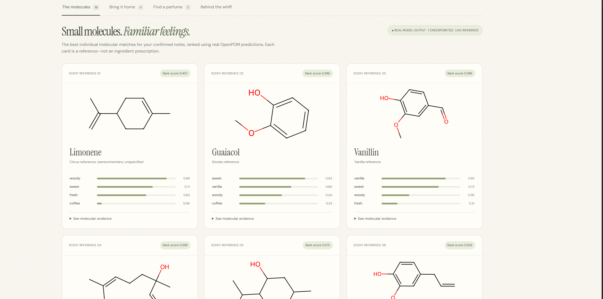
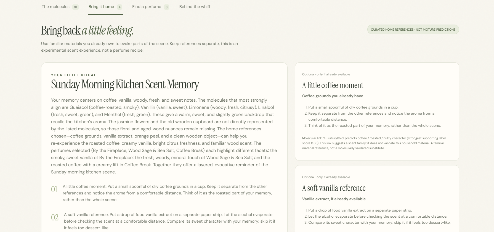
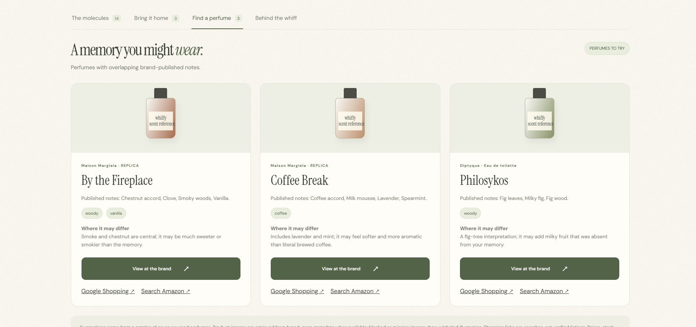
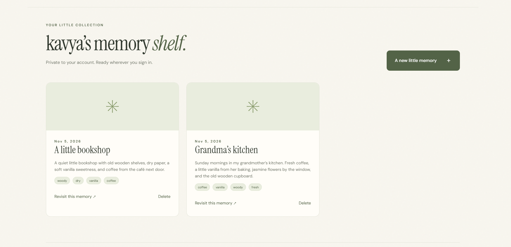

<div align="center">

# ☕ whiffy ✳

### *A little whiff of a memory.*

Turn a written or spoken scent memory into an editable scent brief, **live molecular odor predictions**, familiar home scent references, and perfumes to explore.

[**Live demo →**](https://kavyasingh236.github.io/whiffy/) 




</div>

---

## What it does

Jasmine outside a window. Coffee in a grandmother's kitchen. Old wooden bookshelves.

You describe the memory. Whiffy extracts the scent notes, picks real molecules that could evoke them, scores those molecules with a **graph neural network (OpenPOM)**, and uses that evidence to suggest:

- 🧪 **Molecular matches** with predicted odor-label probabilities
- 🏠 **Home scent references** built from familiar materials
- 🌸 **Perfumes to explore** from a sourced catalog

It does this **without claiming to recover the exact smell of the past**. Whiffy is an exploration tool, and its limits are stated in the app.

## Highlights

- **No hallucinated chemistry.** The LLM only picks IDs from a fixed 30-molecule catalog. The backend resolves the SMILES.
- **Real inference on every request.** RDKit validates structures, OpenPOM returns 138 odor-label probabilities and 256-d embeddings.
- **No silent fallbacks.** If a service fails, the app shows an error and lets you retry. Nothing cached or keyword-based is passed off as a result.
- **You stay in control.** Edit the extracted notes, exclusions, and importance sliders before anything is scored.
- **Private by design.** Google sign-in, per-user memory shelf, Postgres row-level security.
- **Voice or text input** via browser speech recognition.

## Screenshots

**1. Describe a memory**



**2. Confirm your scent notes**: edit notes, add exclusions, set importance.



**3. Your scent echo**



**4. Real OpenPOM molecular matches**



**5. Bring it home** and **6. Find a perfume**

| Home references | Perfumes to explore |
| --- | --- |
|  |  |

**7. Keep it on your private memory shelf**



## How it works

1. **Describe a memory.** Type it or use the microphone.
2. **LLM interpretation.** A server-side model proposes wanted and unwanted OpenPOM odor labels. You confirm and adjust importance.
3. **Grounded molecule selection.** The LLM selects candidate IDs; the backend resolves SMILES. The LLM cannot invent structures.
4. **Live OpenPOM inference.** Selected molecules are scored during the request. Ranking rewards wanted notes and penalizes excluded ones.
5. **Evidence-grounded recommendations.** A final LLM sees the real model scores, your confirmed brief, approved household references, and the sourced perfume catalog, then writes the explanation and makes selections only from those options.
6. **Keep a little memory.** Download a text keepsake or save a compact snapshot to your private shelf.

## The model's role

OpenPOM accepts **single-molecule SMILES**, not memories, fragrance notes, or mixtures. The LLM bridges language to molecules; OpenPOM supplies the molecular odor evidence the final LLM must use.

| Detail | Behavior |
| --- | --- |
| Default checkpoint | Upstream `experiments_1` (small CPU footprint) |
| Supported | 1–10 upstream checkpoints; the app reports how many were actually used |
| Embeddings | Always from `experiments_1`; independently trained spaces are never averaged |
| Benchmarks | A single-checkpoint deployment is **not** described as reproducing an ensemble benchmark |
| Historical data | A genuine 10-checkpoint prediction set is kept for regression tests only, never substituted for live inference |

## Architecture

| Layer | Technology |
| --- | --- |
| Interface | HTML, CSS, JavaScript modules |
| Speech input | Browser SpeechRecognition (where supported) |
| Language model | Groq API or local Ollama, server-side only |
| API | Python 3.10, FastAPI, HTTPX |
| Molecular ML | OpenPOM, PyTorch (CPU), DeepChem, DGL, RDKit |
| Auth and storage | Supabase Auth, Google OAuth, PostgreSQL with row-level security |
| Delivery | GitHub Pages (frontend), Docker image (backend) |

GitHub Pages serves the interface only. **Live inference needs the Python backend running separately.** LLM keys live only in the backend environment, and Google OAuth secrets live in Supabase. The public frontend config contains just the API origin, Supabase URL, and publishable key.

## Privacy

- Submitting a memory sends its text to the backend and the configured LLM provider.
- **Saving is a separate, explicit action.** Drafts aren't stored.
- Saved memories are tied to your account; row-level security enforces ownership.
- The backend validates Supabase bearer tokens, rate-limits per account, and runs one inference job at a time per process (sized for a single-worker portfolio deployment).
- Voice input may send audio to your browser vendor's speech service. Whiffy never stores recordings.
- Brand photos and shopping links contact external sites.

## Run locally

<!-- TODO: verify these commands and env var names against the repo before publishing. -->

**Backend**

```bash
cd backend
python -m venv .venv && source .venv/bin/activate
pip install -r requirements.txt
# download upstream OpenPOM checkpoints (see backend model downloader)
cp .env.example .env        # add LLM provider + Supabase settings
uvicorn main:app --reload
```

**Frontend**

```bash
cd dist
python -m http.server 8000
```

Point the frontend config at your backend origin and Supabase project.

**Docker (backend)**

```bash
docker build -t whiffy-backend .
docker run -p 8080:8080 --env-file backend/.env whiffy-backend
```

Checkpoints download during the image build.

## Repository layout

```
dist/                 web interface, catalog, account + voice modules, historical fixture
backend/              authenticated API, recommendation pipeline, OpenPOM runtime, references, downloader
supabase/             schema, ownership policies, isolation checks
tests/                JS checks: ranking, accounts, speech, live API behavior
.github/workflows/    frontend test + deploy, backend unit tests
Dockerfile            Python CPU backend image
```

## Testing

Automated checks cover:

- label validation and wanted/excluded-note handling
- live model evidence reaching the final LLM prompt
- rejection of invented molecule and product IDs
- authentication and explicit failure behavior
- compact saved snapshots and account switching
- microphone lifecycle

The real CPU checkpoint was also run against all 30 catalog molecules and in an integration run with scripted LLM responses.


## References

- [OpenPOM source and checkpoints](https://github.com/ARY2260/openpom)
- Lee et al., [*A principal odor map unifies diverse tasks in olfactory perception*](https://doi.org/10.1126/science.ade4401), Science (2023)
- Individual compound and brand source links are included in the app's references.

## Acknowledgements

Built on the open-source OpenPOM project and the Principal Odor Map research from Lee et al.

---

<div align="center">

Created by **Kavya Singh** · [Live demo](https://kavyasingh236.github.io/whiffy/)

</div>
